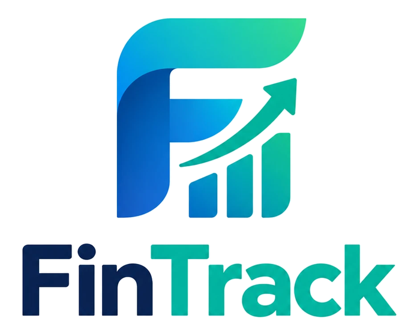

<p align="center">
  
</p>

# FinTrack

A personal finance manager for Windows. Your whole financial picture on one dashboard: money you have, money you owe, money you spend and money you have planned. It is **local-first**: it runs fully offline and keeps everything in a single SQLite file on your PC. Amounts are in **NPR**, and dates can be shown in **AD (English)** or **BS (Nepali, Bikram Sambat)**.

Built with WPF, MVVM and .NET 10. Clean light theme with a blue accent, animated and smooth-scrolling.

## Contents

- [Features](#features)
- [Getting started](#getting-started)
- [Using the app](#using-the-app)
- [Your data and security](#your-data-and-security)
- [Project structure](#project-structure)
- [Tech stack](#tech-stack)
- [Known limitations](#known-limitations)

## Features

**Accounts and net worth**
- Bank accounts, e-wallets (eSewa, Khalti, IME Pay and so on), cash and credit cards, each with a live balance.
- Transfers between any two accounts. A transfer is stored as two linked transactions, so balances stay exact. Paying a credit card is just a transfer to the card.
- Net worth (assets minus liabilities) with a 12-month trend chart.

**Transactions**
- Add income or expenses with amount, account, category, date, note and an optional receipt image.
- Categories and sub-categories (Food, Rent, Transport, Education, Health and more).
- Split bills: one payment spread across several categories.
- Recurring income (salary, freelance, rent received) that posts itself when due.
- Search bar plus a filter pop-up (account, category, date range).
- Signed, colour-coded amounts, category pills and a serial number (SN) column in every table.

**Budgets**
- Monthly limit per category with progress bars and warnings at 80% and 100%.

**Loans and debts**
- EMI loans with an auto-calculated EMI and a full amortization schedule, or fixed (bullet) loans with simple interest.
- Per-row actions in the loan table: mark the next instalment paid (records the expense), edit, delete.
- Friends and family loans: money you gave or took, due dates and partial repayments.
- Payoff planner comparing the avalanche and snowball strategies.
- Prepayment simulator: interest and time saved with extra monthly payments or a lump sum.

**Bills and insurance**
- Subscriptions and bills with billing cycle, next due date, monthly and yearly totals and a "most expensive" list. Marking one paid creates the transaction and moves the due date forward.
- Insurance policies with premium, due date and coverage.

**Savings and goals**
- Goals with target, deadline, progress bar and the monthly saving needed to reach them.
- Fixed and recurring deposit tracker with maturity amounts.
- Savings rate calculator.

**Investments and tools**
- Investments (shares, mutual funds, gold) with purchase value versus current value.
- Yearly income and deductions summary (tax helper).
- Bill splitting: share a group bill equally and track who owes you.
- Currency converter for NPR, USD and INR using rates you set.

**Dashboard and insights**
- Net worth, income, expenses and debt cards, cash flow chart, spending donut, due-soon list, budget and goal progress, recent activity and alerts.
- Financial health score (0 to 100) built from savings rate, debt-to-income, emergency fund months and budget adherence.
- Spending anomaly alerts when a category runs well above its 3-month average.
- 3-month cash flow forecast from recurring income, EMIs and subscriptions.

**Reports, backup and security**
- Month-end report exported to PDF or Excel.
- Backup and restore of the database, optionally password-protected (AES-256).
- First-run setup with your name and a PIN, a login screen, and Log out.

**Interface**
- Pop-up forms for adding and editing, styled confirmation dialogs for anything destructive, show/hide eye on PIN fields.
- AD/BS switch in the header: dates everywhere, and the monthly groupings (totals, charts, forecast, reports), follow the chosen calendar.
- Smooth wheel scrolling, page and card transitions, count-up numbers.

## Getting started

### Requirements

- Windows 10 (build 19041) or Windows 11
- [.NET 10 SDK](https://dotnet.microsoft.com/download) to build from source. The published exe does not need it.

### Run from source

From the repository root:

```bash
dotnet run
```

### Build an exe

Self-contained single file (no .NET install needed on the target PC):

```bash
dotnet publish -c Release -r win-x64 --self-contained true -p:PublishSingleFile=true -p:IncludeNativeLibrariesForSelfExtract=true -o publish
```

The result is `publish/FinanceTracker.exe` (about 200 MB). Keep the `QuestPDF.Fonts.Lato.br` file next to it, because PDF export uses that font. It is large (the .NET runtime and SkiaSharp are bundled). Use `--self-contained false` for a much smaller exe if the .NET 10 Desktop Runtime is installed. The exe is not code-signed, so Windows SmartScreen may ask you to confirm the first run.

### Troubleshooting

**"An Application Control policy has blocked this file"** when starting `FinanceTracker.exe`: Windows Smart App Control (or another application-control policy) blocks unsigned executables, and the exe .NET generates is unsigned.

- From source, just use `dotnet run`. Debug builds do not generate that exe; they run through the signed `dotnet.exe`.
- You can also start a build directly with `dotnet bin/Debug/net10.0-windows10.0.19041.0/FinanceTracker.dll`.
- A published Release `FinanceTracker.exe` is unsigned too, so it is blocked on PCs with Smart App Control on. Either run the published `FinanceTracker.dll` with `dotnet`, or sign the exe with a code-signing certificate. (Turning Smart App Control off works but cannot be undone without reinstalling Windows, so it is not recommended.)

## Using the app

1. **First launch:** enter your name and choose a PIN of at least 4 digits (or skip the PIN). The eye button shows what you typed.
2. **Add accounts first** (Accounts, Add Account). For a credit card, enter the amount you currently owe as the opening balance.
3. **Record transactions** from Transactions, Add Transaction. Use Split Bill for one payment across several categories.
4. **Set budgets, loans, bills and goals** from their pages. Each page has an add button that opens a pop-up.
5. **Switch AD/BS** in the header any time. Dates you type into forms are always AD (`yyyy-mm-dd`); everything the app shows, and how it groups months, follows the switch.
6. **Log out** (header) to return to the login screen. Without a PIN, logging out closes the app.

Handy shortcuts: `Esc` closes any pop-up, `Enter` saves it, and pressing `Enter` in the header search jumps to matching transactions.

## Your data and security

Everything is stored locally. Nothing is sent anywhere.

| What | Where |
| --- | --- |
| Database | `%AppData%\FinanceTracker\finance.db` |
| Receipt images | `%AppData%\FinanceTracker\receipts\` |
| Error log | `%AppData%\FinanceTracker\error.log` |

Set the `FT_DATA` environment variable to use a different folder (handy for testing with a throwaway database).

- **PIN:** stored only as a salted PBKDF2-SHA256 hash. Five wrong attempts lock the login screen for 30 seconds.
- **Backups:** a password-protected backup is encrypted with AES-256-GCM (key derived with PBKDF2). The password cannot be recovered, so keep it safe. Restoring keeps a copy of your current file as `finance.db.before-restore`.
- **Important:** the live database file itself is **not encrypted**. The PIN is an app lock, not disk encryption. Use Windows BitLocker or similar if the PC is shared. There is no "forgot PIN" recovery.

## Project structure

```
App.xaml(.cs)             Startup, global error handler, smooth scrolling, login flow
MainWindow.xaml           Shell: sidebar, header (search, AD/BS, alerts, log out)
LockWindow.xaml           First-run setup and login screen
FinanceTracker.csproj     Project file
Models/                   EF Core entities (Account, Transaction, Loan, Goal, ...)
Data/AppDb.cs             DbContext, database location, first-run seed data
Services/
  FinanceService.cs         Balances, net worth, budgets, health score, forecast, alerts
  LoanCalculator.cs         EMI, amortization, payoff planner, prepayment, deposits
  NepaliCalendar.cs         AD/BS conversion (BS 1975 to 2100 month-length table)
  DateDisplay.cs            AD/BS display and month-grouping rules used everywhere
  SystemServices.cs         PIN, backup/restore, toasts, PDF/Excel export, profile
ViewModels/               One view model per page (CommunityToolkit.Mvvm)
Views/                    Pages, pop-up forms and dialogs
Controls/                 CountUp, PinBox, DialogBase, SmoothScroll
Themes/
  Theme.xaml                Colours, buttons, inputs, tables, scrollbars, animations
  Forms.xaml                Field layouts for every pop-up form
```

## Tech stack

| Area | Choice |
| --- | --- |
| UI | WPF with MVVM ([CommunityToolkit.Mvvm](https://learn.microsoft.com/dotnet/communitytoolkit/mvvm/)) and a custom theme |
| Database | SQLite through Entity Framework Core |
| Charts | [LiveCharts2](https://livecharts.dev/) (SkiaSharp) |
| PDF export | [QuestPDF](https://www.questpdf.com/) (Community license) |
| Excel export | [ClosedXML](https://github.com/ClosedXML/ClosedXML) |
| Notifications | Windows toast notifications |

The Nepali calendar month lengths come from the open-source [npdatetime](https://docs.rs/crate/npdatetime) dataset and were checked against known anchor dates (BS 2083-01-01 is 14 April 2026). Month lengths are published, not calculated, so dates outside BS 1975 to 2100 fall back to AD.

## Known limitations

- **Windows only**, single user, one database.
- **Schema changes:** the database is created with `EnsureCreated`, not migrations. Adding or changing columns needs a move to EF migrations first.
- **LiveCharts2** is used at a prerelease version.
- **QuestPDF** is used under its Community license; check that your use qualifies before distributing.
- **Months follow the AD/BS switch.** In BS mode, month totals, budgets, charts, the forecast, the health score and reports use Nepali months, and the tax helper uses the BS year. Loan, bill and deposit schedules still step by AD months, and credit-card due days are AD days of the month.
- **Net worth trend:** only account balances are historical. Loans, investments and deposits are held at today's value across the whole trend.
- **Cash flow forecast** uses only recurring income, EMIs and subscriptions. Everyday spending is not projected.
- **Tax helper** sums income and flagged deductible categories only. It applies no tax slabs and is not tax advice.
- **Currency rates** are entered by you (Settings), not fetched online.
- **Reminders:** toast notifications for items due within 3 days are shown at startup. The per-bill "remind days" value is stored but not yet used for toasts, and toasts may not appear for an unpackaged exe on every Windows setup. The in-app alerts and bell always work.
- **Tests:** there is no automated test suite yet.
- No licence is specified. Add one before publishing the repository.
